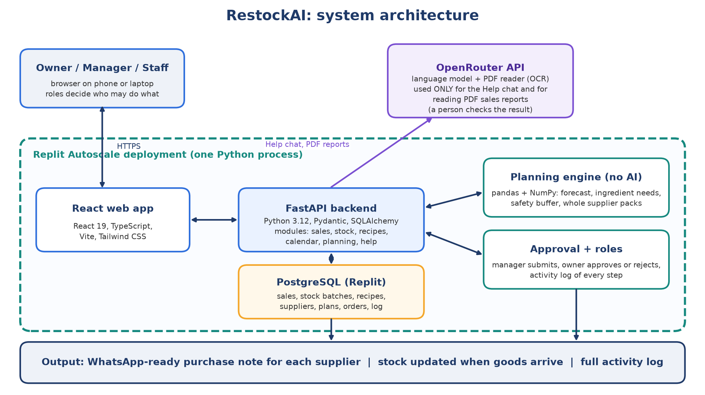

# RestockAI

> Smart purchase planning for small food businesses: from about two days of manual calculation to a few minutes, with a person approving every order.

---

## Team Information

| Field | Details |
|---|---|
| **Team Name** | Small x Big y |
| **Team Domain** | Domain 2: Orbyte Smart SME Challenge |
| **SDG Track (1-17)** | SDG 12 (Responsible Consumption and Production), target 12.3. Also supports SDG 8 (targets 8.2 and 8.3). |
| **Team Leader** | Eishvar |
| **University** | AIMST University |
| **Number of Members** | 4 (Eishvar, Joey Khor, Aswindra Selvam, Virochan) |
| **Solution** | RestockAI |

## Links

| Resource | Link |
|---|---|
| GitHub Repository | https://github.com/Eishvar/restockiq |
| Replit Project | https://replit.com/@eishvar2020/restockiq |
| Live Demo | https://restockiq.replit.app |
| RunPod Endpoint | Not used (no GPU work, see "How we used Replit and RunPod") |
| Slide Deck | https://canva.link/9qbxm0hc9hg3pfl |
| Demo Video | **[ADD LINK]** |
To try the demo, open the live link and pick a user on the sign-in screen: **Ah Hock (owner)**, **Siti (manager)** or **Ravi (staff)**. Sign-in is simulated in this prototype.

---

## Overview

Built for the SDC Hackathon 2026 (XMUM), Domain 2, "Orbyte Smart SME Challenge". All data in this repository is **synthetic**.

### Problem

Owners of kopitiams, cafés and campus eateries decide every week what to buy, usually by hand from memory, notebooks, WhatsApp and spreadsheets. We estimate this takes about two days per purchasing cycle (a team estimate, to be checked with owners). Buy too much and fresh stock expires; buy too little and dishes sell out. Food service causes 28% of the world's food waste (UNEP Food Waste Index Report 2024).

### Solution: what RestockAI does (the journey)

1. **Trigger:** a manager or the owner picks how many days ahead to plan and presses **Generate plan**.
2. **Connected data:** sales history, recipes, stock with expiry dates, suppliers, and a calendar of holidays and events.
3. **Decision logic:** a statistical forecast per dish, converted into ingredient needs, minus usable stock, plus a **safety buffer measured from the app's own past forecast errors**, rounded up to whole supplier packs. Fast-spoiling items are bought in several trips. Every line has a plain-words "Why?". There is no AI in this maths.
4. **Human approval:** the manager edits and submits; the **owner approves or rejects**.
5. **Outcome:** a WhatsApp-ready purchase note per supplier, stock updated when goods arrive, and every step in an **activity log**. The app never pays or transfers money.

**Where AI is used (and where it is not):** the language model is used in two places only: the **Help chat** (explains how to use the app; sees no business data; changes nothing) and **reading PDF sales reports** (a person checks and can fix the result in a preview before anything is saved). Forecasts, buffers and quantities use no AI. If AI is unavailable, manual forms and CSV or Excel upload still work.

## Roles

| Role | Can do |
|---|---|
| Owner | Everything: setup, approve or reject orders, settings, delete sales for good |
| Manager | Plan purchases, edit and submit orders, mark received, update stock, recipes, calendar, upload sales |
| Staff | View, and update stock quantities |

## Fit with the Orbyte hub

RestockAI is built as a module of a shared business hub: multi-tenant (every table has a `tenant_id`), no restaurant-specific code (menus, recipes, shelf lives and calendars are data), and a reusable JSON API (`/api/*`). A business with a different menu or suppliers only needs its own data.

## Benefit and SDG link

- **SDG 12.3** (halve food waste at retail and consumer levels): shelf-life-aware buying and expiry tracking reduce spoilage.
- **SDG 8.2 and 8.3** (productivity, support for small businesses): the owner's planning time drops from about two days to minutes.
- On our synthetic demo data the daily-total forecast is off by about **13%** on a typical day, against about **28%** for a simple 4-week average. A forecast audit on eight simulated restaurant types gave 12% to 22% error. See `research/forecast_audit/FORECAST_AUDIT.md`. These numbers come from synthetic data, not from real shops.

## Privacy (PDPA, Malaysia)

The prototype uses no real personal data: users are fictitious, and sales, stock and supplier data are synthetic. Help questions (with the person's role and page, no business data) and uploaded PDF reports are sent to the AI provider (OpenRouter); CSV and Excel files never leave the app. API keys live in Replit Secrets, not in the code. A real deployment would follow the PDPA: consent, limited purpose, retention limits and deletion on request.

## Hardest risk and fallback

The hardest risk is that real sales behave in ways our simulations do not (for example long stretches of sold-out days, or a promotion nobody told the app about). The fallback is built in: every purchase line shows its safety buffer, the owner approves or edits each order before it is sent, every decision is logged, and with fewer than 12 past cases the app uses a default 15% buffer instead of a measured one.

## How to run the project

You need Python 3.12 and Node.js 20.

```bash
# 1. Backend (http://localhost:8000)
cd backend
python -m venv .venv
.venv\Scripts\activate            # Windows. On macOS/Linux: source .venv/bin/activate
pip install -r requirements.txt
python -m app.seed.load --reset   # loads the synthetic demo data (about 10 seconds)
uvicorn app.main:app --reload --port 8000

# 2. Frontend (http://localhost:5173, proxies /api to port 8000)
cd frontend
npm ci
npm run dev
```

- Copy `.env.example` to `.env` for local settings. The AI features need `OPENROUTER_API_KEY` and `OPENROUTER_MODEL`; without them the rest of the app still works. Never commit a real key.
- Run the tests: `cd backend && pytest -q` (backend) and `cd frontend && npm run test:ui` (frontend helpers).
- The first time the owner signs in, a short setup wizard checks the country, sales history, stock and recipes.
- Single-process production build: `cd frontend && npm run build`, then run the backend; FastAPI serves `frontend/dist` at `/` and the API at `/api/*`.

## Overall project structure

```
restockiq/
├── backend/
│   ├── app/
│   │   ├── engine/        pure forecast, safety-buffer and purchasing maths (pandas / NumPy; no database, web or AI)
│   │   ├── modules/       one folder per feature: planning, inventory, sales_data, recipes (catalog),
│   │   │                  calendar, settings, setup, activity, help, dashboard
│   │   ├── core/          roles and sign-in, activity log, units, clock
│   │   ├── ai/            the only place the language model is called (llm.py) and its prompts
│   │   └── seed/          loads the demo data
│   └── tests/             289 automated tests
├── frontend/src/features/ one folder per screen: planning, inventory, sales, recipes, calendar, settings, help, ...
├── data/                  synthetic demo data and the scripts that generate it
│   └── demo_reports/      a pre-made sales report (PDF and CSV) to upload in the demo
├── research/forecast_audit/  accuracy checks on simulated restaurants
├── RestockAI_system_diagram.png   system block diagram
├── IMPLEMENTATION_PLAN.md, DEPLOY.md, CLAUDE.md
└── LICENSE (Apache-2.0)
```



## How we used Replit and RunPod

- **Replit:** the live prototype runs on a **Replit Autoscale deployment** (one Python process serving the web app and API), with **Replit PostgreSQL** as the database and **Replit Secrets** for the AI key. We also used the Replit workspace and the **Replit Agent** for part of the development. See `DEPLOY.md` for the exact setup.
- **RunPod:** **not used.** The forecast is statistics on a CPU, and the language model is called through an API, so the project needs no GPU.

## Tools we used to build it

Claude Code and the Replit Agent helped write code (declared in our Technical Tools Declaration). Third-party libraries and their licences are listed there too.

## Licence

Apache-2.0. See `LICENSE`.
